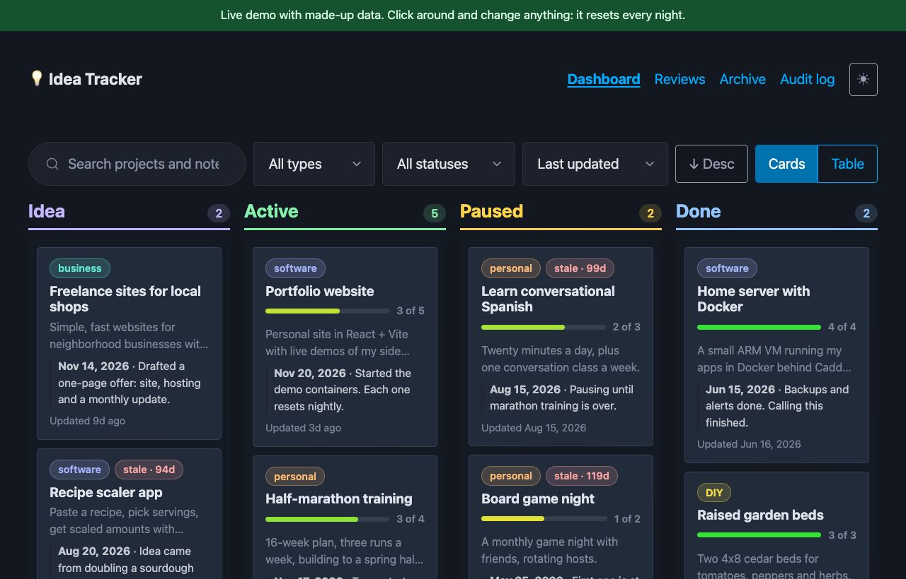
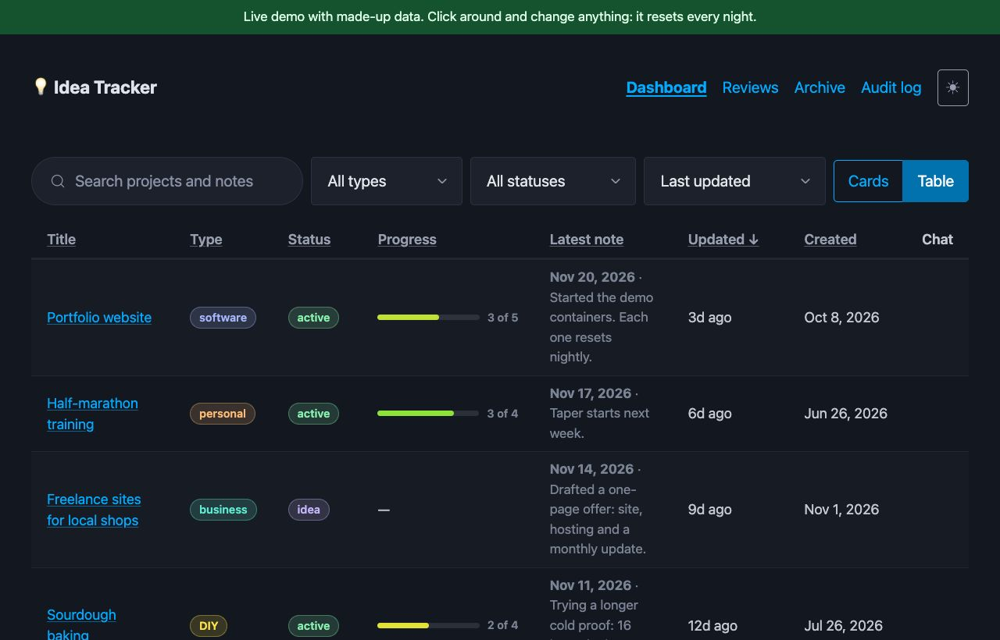
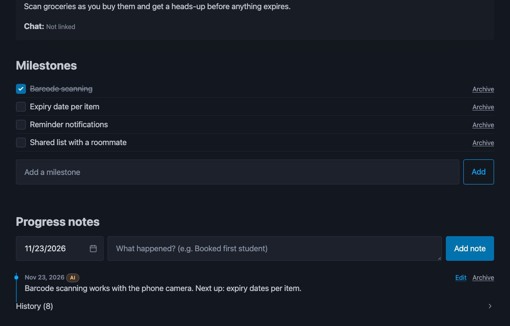
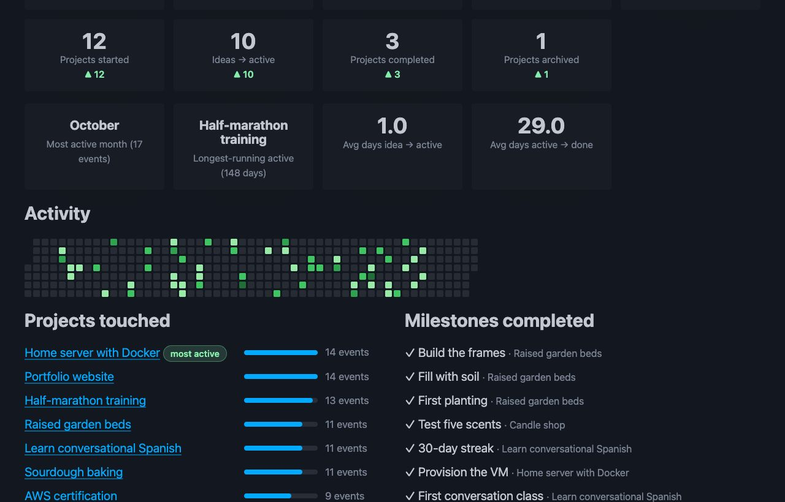

# Idea Tracker

[](https://github.com/jellyman552/idea-tracker/actions/workflows/tests.yml)

A personal tracker for project ideas and their progress, built so your AI assistant can keep it up to date for you. It ships with a remote [MCP](https://modelcontextprotocol.io) server, so Claude, ChatGPT, Cursor or any other MCP client can create projects, tick milestones and log progress straight from a conversation.



| Table view | Project page | Yearly review |
| --- | --- | --- |
|  |  |  |

## Features

- **Dashboard** with two views:
  - **Cards**: one column per status (Idea, Active, Paused, Done).
  - **Table**: every project in one table, sortable by clicking a column header.
- **Live search** as you type, across titles, summaries and notes. There are also filters by type and status, and sorting by last updated, created, title, type, status or progress.
- **Milestones and progress bar.** The bar shows done ÷ total ("3 of 5") and goes from red to yellow to green.
  - Ticking the last milestone moves the project to Done.
  - Unticking one moves the project back to its previous status.
- **Progress notes**, with dates you can change, shown on a timeline. Notes your AI writes get an "AI" badge.
- **Archive and restore.** Archived projects, notes and milestones are hidden and become read-only. Restore them from the Archive page. Nothing is ever deleted.
- **Audit log.** Every create, edit and archive is recorded with the old and new values and where the change came from (`web`, `cli` or `mcp`).
- **Stale detection:** active and paused projects go stale after 14 quiet days, ideas after 60. Shows a badge, a "Stale only" filter, and a "Keep it" (snooze) button.
- **Reviews tab:** weekly, monthly and yearly stats (projects touched, milestones, status changes, by type, a yearly heatmap) plus a reflection form.
- **GitHub commits** from linked repos, synced on a timer.
- **Works on phones** and installs to your Home Screen like an app. Dark and light themes.
- **Single-user login** with CSRF protection on every form.

## Run it yourself

You need a machine with Docker, and a domain (or a free [DuckDNS](https://www.duckdns.org) subdomain) pointing at it with ports 80 and 443 open. Caddy gets the HTTPS certificate automatically.

```bash
git clone https://github.com/jellyman552/idea-tracker.git
cd idea-tracker
cp .env.example .env      # set DOMAIN, ADMIN_USERNAME, ADMIN_PASSWORD, SECRET_KEY, MCP_TOKEN
docker compose up -d
```

Open `https://<your DOMAIN>` and sign in with `ADMIN_USERNAME` / `ADMIN_PASSWORD`. Your data lives in the `data` Docker volume (`instance/tracker.db`).

- **Prebuilt image:** `docker compose up` pulls `ghcr.io/jellyman552/idea-tracker:latest` (amd64 and arm64, so it runs on a Raspberry Pi or an ARM cloud VM too). Add `--build` to build from source instead.
- **Updating:** `docker compose pull && docker compose up -d`. Database migrations run on start.
- **Backups:** [deploy/backup.sh](deploy/backup.sh) makes a safe online copy of the database and keeps 30 days. [deploy/](deploy/) has systemd units to run it nightly and to sync GitHub commits every 3 hours.

### On your phone

Open your Idea Tracker in Safari (iPhone) or Chrome (Android) and choose **Share › Add to Home Screen** (or **Install app**). It opens full screen like a native app.

### Configuration (`.env`)

| Variable | Required | Purpose |
| --- | --- | --- |
| `DOMAIN` | yes | Hostname you serve it on (used by Caddy and the MCP server) |
| `ADMIN_USERNAME`, `ADMIN_PASSWORD` | yes | Login, created on first start. Change the password and restart to reset it |
| `SECRET_KEY` | yes | Signs session cookies |
| `MCP_TOKEN` | for AI access | Secret in the MCP URL, 32+ characters. Empty turns MCP off |
| `TIMEZONE` | no | Timezone dates are shown in (default `America/Los_Angeles`) |
| `GITHUB_TOKEN` | no | Fine-grained, read-only token for syncing commits |
| `DATABASE_URL` | no | SQLAlchemy URL (default `sqlite:///instance/tracker.db`) |

Generate secrets with `python3 -c 'import secrets; print(secrets.token_hex(32))'`.

## Connect your AI

Your MCP URL is:

```
https://<your DOMAIN>/mcp/<MCP_TOKEN>
```

The token in the path is the password, so keep the URL private. Any other path under `/mcp/` returns 404, and the server writes no access logs, so the token never lands in a log file. It works with any client that supports remote MCP servers over Streamable HTTP:

- **Claude** (web, desktop and phone apps): Settings › Connectors › Add custom connector, then paste the URL. It syncs to all your Claude apps.
- **Claude Code:** `claude mcp add --transport http --scope user idea-tracker "<URL>"`
- **ChatGPT:** add it as a custom connector (MCP server) in ChatGPT's settings, with no authentication, and paste the URL. Custom connectors depend on your ChatGPT plan; see OpenAI's help pages for where the setting currently lives.
- **Cursor:** add it to `~/.cursor/mcp.json`:
  ```json
  { "mcpServers": { "idea-tracker": { "url": "<URL>" } } }
  ```
- **Anything else:** point an MCP client at the URL. No API key or OAuth is needed.

The server sends the assistant instructions along with the tools: check for duplicates before creating a project, confirm before archiving, and log a short note when a conversation reaches a decision.

### Tools

| Tool | What it does |
| --- | --- |
| `list_projects`, `get_project` | Read projects, milestones (with ids) and recent notes |
| `create_project` | New project, optionally with starting milestones and the chat's link |
| `update_project` | Title, type, status, summary, chat link, GitHub repo |
| `add_note`, `update_note` | Progress notes (date defaults to today) |
| `add_milestones`, `set_milestone_done` | Checklist. Ticking the last one moves the project to Done |
| `archive_project`, `archive_note`, `archive_milestone` | Hide items (the assistant confirms with you first) |
| `unarchive_project`, `unarchive_note`, `unarchive_milestone` | Restore archived items |
| `get_stale_projects`, `snooze_project` | Quiet projects, and "keep it" to reset the clock |
| `get_review`, `save_review_reflection` | Weekly/monthly/yearly review stats, and saving your reflection |

## GitHub commits

Link a project to a repo (edit form, or `update_project` via MCP). `flask --app tracker sync-github` pulls new commits for linked repos using `GITHUB_TOKEN` (fine-grained, read-only, Contents: read). Commits show on the project page, count as activity (so active coding keeps a project from going stale), and appear in reviews. Each commit is stored once, and a failing repo is logged and retried next run.

## How it's built

Flask, Flask-SQLAlchemy (SQLite), Flask-Login, Jinja templates and [Pico CSS](https://picocss.com), with no frontend build step. The MCP server uses the official Python MCP SDK. One process serves both: [tracker/asgi.py](tracker/asgi.py) sends `/mcp/*` to the MCP app and everything else to Flask, under uvicorn.

Every change, from the web UI, the CLI or MCP, goes through [tracker/services.py](tracker/services.py), which validates input and writes the audit log. Stale detection and reviews are computed from that audit log plus synced commits, so there is no second copy of history to keep in sync.

```
tracker/
  __init__.py     app factory, CSRF check, date filters, service worker route
  asgi.py         one ASGI app: Flask + the MCP server under /mcp/<token>
  models.py       Project, ProgressLog, Milestone, AuditLog, Review, Commit, User
  services.py     every change goes through here and gets audited
  projects.py     dashboard, project, note, milestone, archive and audit routes
  reviews.py      weekly / monthly / yearly reviews
  activity.py     activity history and stale detection
  mcp_server.py   the MCP tools
  github_sync.py  commit sync
  cli.py          create-user, ensure-user, seed, seed-demo, sync-github
  demo.py         fictional demo data (DEMO_MODE)
migrations/       versioned schema migrations (Flask-Migrate)
tests/            pytest suite
deploy/           backup script and systemd units
```

## Development

```bash
python3 -m venv venv && source venv/bin/activate
pip install -r requirements.txt
cp .env.example .env                              # at least SECRET_KEY
flask --app tracker db upgrade
flask --app tracker create-user <username>        # prompts for a password
flask --app tracker run --debug                   # http://127.0.0.1:5000
pytest -q                                         # ~110 tests, a few seconds
```

After changing `models.py`, run `flask --app tracker db migrate -m "what changed"`, review the generated file, then `flask --app tracker db upgrade`.

**Demo mode:** with `DEMO_MODE=1`, visitors are signed in automatically as a demo user and see a banner. `flask --app tracker seed-demo` fills an empty database with fictional projects and about ten months of history.

## License

MIT. See [LICENSE](LICENSE).
